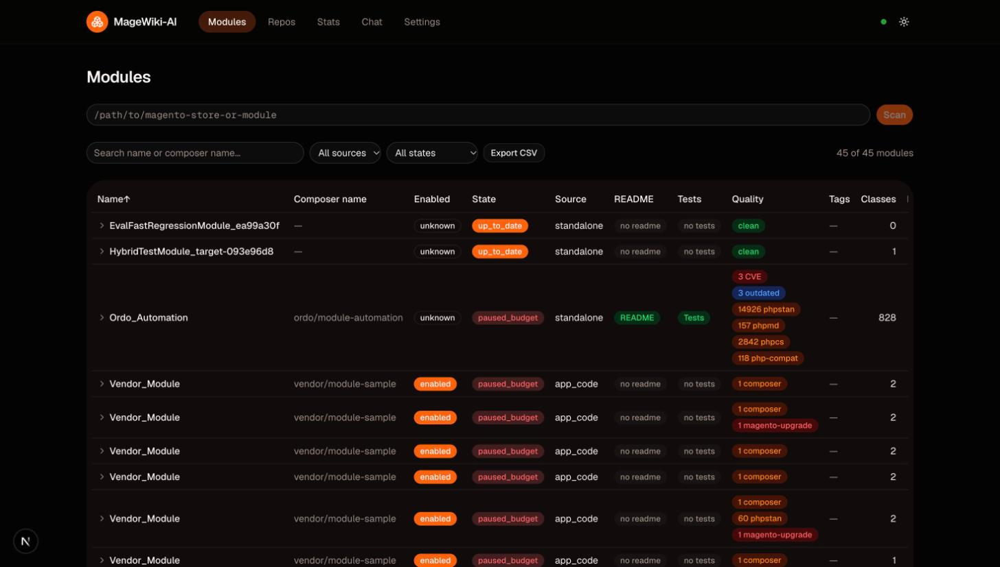
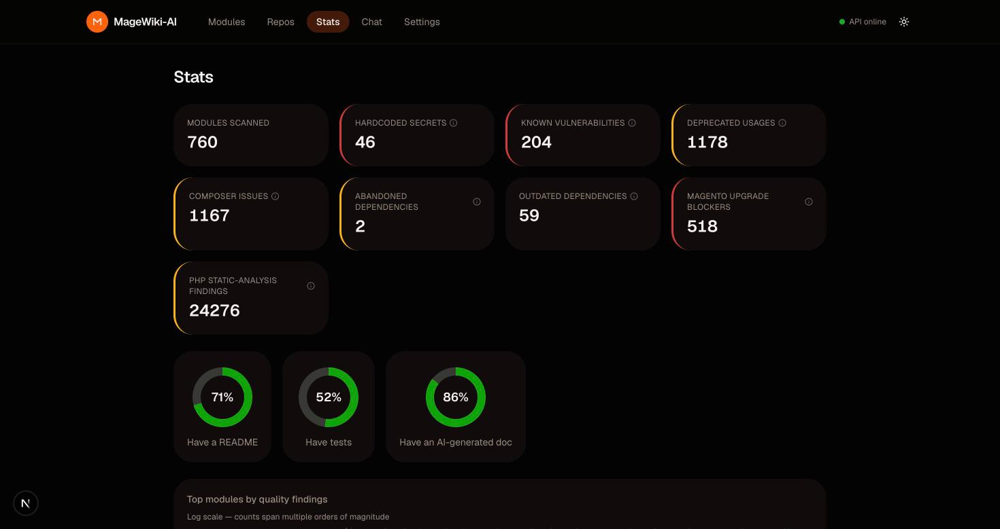
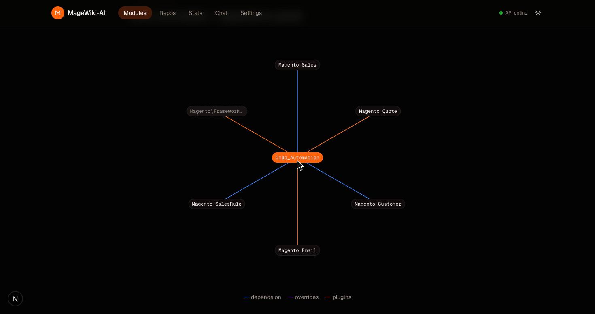
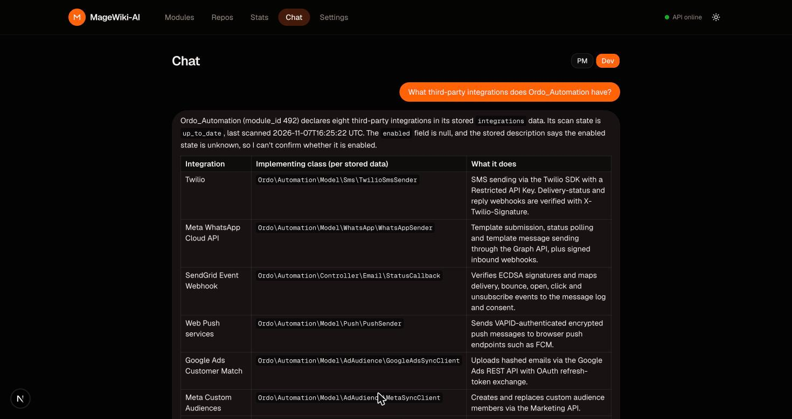

# MageWiki-AI


[](https://magewiki-web.fly.dev/modules?has_doc=true)
[](https://codecov.io/gh/michalper/magewiki)
[](https://sonarcloud.io/summary/new_code?id=michalper_magewiki)
[](LICENSE)


An AI-powered catalog and chat agent for Magento 2 codebases. MageWiki-AI scans Magento modules (`module.xml`, `composer.json`, `di.xml`, `events.xml`, `Plugin/` classes), builds a knowledge base in PostgreSQL, and lets developers and PMs ask natural-language questions about the architecture — with every answer citing the module and file it came from. It also runs a battery of quality, security, and Magento-upgrade-readiness checks on every scanned module and surfaces the results as badges, a stats dashboard, and a multi-repo fleet view — including **cross-module conflict detection**: two modules fighting over the same plugin hook, a Composer package version range, or a REST route don't fail quietly until someone hits the bug in production; MageWiki flags the exact pair and why.

Project status: **all 20 planned phases done** (0–12b, 13–19) — the MVP (v1.0, Phases 0–5) plus cron/webhook automation, BYOK in the UI, Ollama support, a per-module dependency graph, an evaluation suite, CI/CD, a local Kubernetes deployment, parser-only quality checks, CVE/dependency intelligence, a multi-repo fleet view, a real PHP static-analysis toolchain (PHPStan/PHPMD/phpcs/Rector), Magento-upgrade-readiness checking, deeper structural facts (webapi/crontab/db_schema/system.xml), a second round of cross-module conflict detection (`di.xml` preferences, `crontab.xml` jobs, GraphQL fields), per-module change history, opt-in RAG query rewriting, webhook alerting on new secrets/CVEs, and a third round of conflict detection on `acl.xml` admin-ACL resources plus an unprotected-admin-controller check. See [Roadmap](#roadmap) below and `CLAUDE.md` for the full design, including the recorded decision behind each phase.

**[Live demo](https://magewiki-web.fly.dev/modules?has_doc=true)** — seeded with a real scan (Magento core + a real third-party module), not synthetic data. The link leads with the modules that already have a full AI-generated analysis; clear the filter to see the whole fleet. The deployment has no scan root or LLM key configured, so Scan and Chat are effectively read-only there — it's meant as a look at already-collected data, not a sandbox to scan your own code or run live chat against.

**[See the full Wiki](https://github.com/michalper/magewiki/wiki)** for a screen-by-screen walkthrough — every screenshot there is a real scan of [Ordo_Automation](https://github.com/michalper/ordo), not a synthetic demo. **[See `docs/architecture.md`](docs/architecture.md)** for the reasoning behind the retrieval design, the anti-hallucination guarantees, and how LLM cost is kept bounded — the "why", not just the "what".

## Screenshots

| Modules | Stats |
|---|---|
|  |  |

| Dependency graph | Chat |
|---|---|
|  |  |

## Stack

- Backend: Python, FastAPI, async SQLAlchemy, Alembic
- Database: PostgreSQL + pgvector, tsvector, pg_trgm
- Frontend: Next.js (App Router), TypeScript, Tailwind, shadcn/ui, TanStack Query
- Queue: ARQ + Redis (nightly rescan cron + a daily Magento-release-cache refresh cron)
- LLM: LiteLLM (BYOK — Anthropic Claude for now, DeepSeek/Ollama supported; see `CLAUDE.md`)
- PHP static analysis: a dedicated `php-analyzer` sidecar (plain PHP, no framework) running PHPStan, PHPMD, phpcs, Rector, and PhpMetrics against scanned modules, reachable only on the internal Docker network
- Real test execution: the same sidecar actually runs a module's own `Test/Unit/` suite via its own `vendor/bin/phpunit` (when the module ships one) — pass/fail counts and code coverage, sandboxed (no network egress for the container, disabled shell/process functions, a wall-clock timeout)

Full architecture and phase plan: see `CLAUDE.md`.

## What the AI is for, what it costs, and why you need an API key

MageWiki-AI's **scanner is 100% free and local** — module discovery, every
XML/composer/PHP parser, the dependency graph, and the entire PHPStan/PHPMD/
phpcs/Rector + CVE/abandoned-dependency/Magento-upgrade-readiness quality
toolchain run with no AI involved and no API key at all. You can `docker
compose up` with every key left blank and still get a fully populated
Modules/Stats/Repos UI, a dependency graph, and every quality badge — the AI
only adds two things on top of that:

1. **Per-module documentation** (the README tab on a module's page: summary,
   features, integrations, risks, PM/dev write-ups) — an LLM call per
   changed file, plus one per module to synthesize them together.
2. **The chat agent** (natural-language Q&A with citations) — an LLM call
   per message, plus a one-time embeddings call per analyzed file/chunk so
   the agent's hybrid search has something to retrieve from.

Both call a real, paid third-party API via [LiteLLM](https://docs.litellm.ai/)
(BYOK — bring your own key, no shared/free tier bundled with this project),
which is why `ANTHROPIC_API_KEY` and `OPENAI_API_KEY` exist in `.env.example`:
Anthropic Claude for the two write-ups above and the chat agent, OpenAI for
embeddings. Leave both blank to run the free, AI-less half of the product;
add them (and optionally lower `LLM_MONTHLY_BUDGET_USD`, default $20) when
you want generated docs and chat. DeepSeek/Ollama are wired as dormant,
cheaper/local BYOK alternatives to Anthropic — see `CLAUDE.md`.

Measured against a real 760-module Magento store (not a synthetic benchmark):

| Step | Model | Cost |
|---|---|---|
| Per-file summary | `anthropic/claude-haiku-5-5` | ~$0.002/file |
| Module synthesis | `anthropic/claude-haiku-5-5` | ~$0.002/module |
| Module synthesis | `anthropic/claude-sonnet-5-5` (optional `SYNTHESIS_MODEL` override — see CLAUDE.md) | ~$0.08/module |
| Embeddings | `openai/text-embedding-3-small` | ~$0.02/million tokens (negligible per module) |
| Chat | whatever `LLM_MODEL` is configured | one LLM call per message, same budget pool as the above — no separate figure measured yet |

Haiku is the default everywhere — cheap, and reliable enough for per-file summaries.
At real fleet scale it fails module-level synthesis validation on a meaningful
share of modules (a much larger, stricter JSON object than a file summary); the
optional `SYNTHESIS_MODEL` override trades ~40x the per-module cost for
materially higher reliability on that one step only. For the full 760-module
store, a one-time full-fleet synthesis backfill on Sonnet cost roughly **$30**
total — budget accordingly if you enable the override on a large existing
store rather than a fresh/incremental scan (which only re-synthesizes modules
whose files actually changed, so ongoing cost is far lower than a backfill).

`LLM_MONTHLY_BUDGET_USD` is a hard safety cap, not just an estimate: every AI
call checks spend-so-far first, and once the cap is hit, affected modules move
to a `paused_budget` state (visible on the Modules page) instead of silently
continuing to spend — see `CLAUDE.md`'s "Scan, cron, and cost control" for how
it's enforced and how to resume paused modules once you raise it.

## Cross-module conflict detection

Every quality check above looks at one module at a time. These five look across
the whole scanned fleet for a pair of modules that silently fight over the same
thing — all free, parser-derived, zero AI involved:

- **Plugin conflicts** — two modules each hooking the same class/method with an
  `around` plugin (execution order isn't guaranteed), or colliding on the exact
  same `sortOrder`.
- **Composer version conflicts** — two modules requiring incompatible version
  ranges of the same package (including `magento/module-*` packages between
  extensions targeting different Magento versions) — `composer install` can only
  resolve one version for the whole store.
- **webapi.xml route conflicts** — two modules declaring the exact same REST
  route (`url` + HTTP method); Magento merges every module's route table, and an
  exact duplicate means one module's service silently wins.
- **db_schema.xml column conflicts** — two modules declaring the same database
  column with a different type or nullability; Magento's declarative schema
  merges modules by sequence order, so one definition silently wins.
- **Circular module dependencies** — module A sequenced after B, after C, after
  A in `module.xml`. Unlike the other four, this one is a guaranteed break:
  Magento's own `setup:upgrade` fails outright on a circular sequence.

Each scanned repo also exports a standard **CycloneDX SBOM** (`GET /repos/sbom` or
the "Download SBOM" button on the Repos page) — one component per module, with its
composer name, resolved version, license, and purl — ready to feed into
Dependency-Track or any other SBOM-consuming tool.

A separate per-module **license-risk** check flags a composer.json declaring a
strong-copyleft license (GPL/AGPL/SSPL) — a real redistribution obligation worth
reviewing before bundling it into a commercial store.

## Real-world results

Every number below is from a real scan — a full `magento/magento2` checkout
(the actual Adobe/Magento core, not a synthetic fixture) plus
[Ordo_Automation](https://github.com/michalper/ordo), reproducible by anyone
cloning the same repos:

| | |
|---|---|
| Modules scanned | 223 (magento/magento2 `app/code`) + Ordo_Automation (standalone) |
| PHP classes catalogued | 17,331 |
| `di.xml` plugins / event observers | 291 / 235 |
| Real CVEs found (`security_advisory`) | 15 — via live Packagist advisory data, not a static list |
| PHPStan findings | 24,360 |
| phpcs violations (project's own ruleset, not a generic default) | 10,828 |

The one worth calling out specifically: **MageWiki found 71 real plugin-conflict
findings inside Magento's own core codebase** — e.g. `Magento_CatalogSearch`'s
`around` plugin on `Catalog\Model\ResourceModel\Product::save` and
`Magento_Quote`'s `after` plugin on the same method both default to
`sortOrder` 0, making their relative execution order genuinely ambiguous. This
isn't a contrived example; it's Magento's shipped core, and anyone can verify
it by scanning the same checkout.

The hardcoded-secret scanner also earns its keep on real code: 36 findings
across both repos, every one of them a fake credential literal inside a
`Test/Unit/*Test.php` file (`CredentialsValidatorTest.php`,
`AuthObserverTest.php`, ...) — exactly the kind of thing worth a second look
in a diff, correctly separated from the zero real secrets actually present.

Ordo_Automation's own real PHPUnit suite (1,514 classes, 3,013 tests) runs
inside the sandboxed `php-analyzer` sidecar end to end — 0 failures, 96.99%
line coverage, confirmed against a real `pcov`-instrumented run. See
`CLAUDE.md`'s "Real PHPUnit test execution" entry for the full sandboxing
writeup: wall-clock kill timeout, disabled shell-spawning functions,
network-isolated container.

## Roadmap

- [x] **Phase 0** — Repo skeleton, docker-compose, migrations
- [x] **Phase 1** — Scanner: module discovery, XML/composer/PHP parsers, saved to the DB
- [x] **Phase 2** — Per-file hash, diff, module state machine, ARQ+Redis queue
- [x] **Phase 3** — AI analysis: JSON schema, tag dictionary, cache, cost tracking, budget, README from the DB
- [x] **Phase 4** — Embeddings and hybrid retriever (vector + FTS + trigram, RRF)
- [x] **Phase 5** — Agent with tools, SSE chat, citations, pm/dev modes
- [x] **Phase 6** — Cron, HMAC webhook, BYOK in the UI, Ollama, dependency graph
- [x] **Phase 7** — Evaluation suite (recall@k, MRR, negative/enumeration questions)
- [x] **Phase 7b** — CI/CD (GitHub Actions): lint, tests, Docker build, and the PR-comment RAG eval all verified green
- [x] **Phase 8** — Kubernetes: Kustomize manifests, scan CronJob, verified end-to-end on a local `kind` cluster
- [x] **Phase 9** — Parser-only quality checks (composer completeness, `@deprecated`, hardcoded secrets, test presence) + badge/KPI-ring UI foundation
- [x] **Phase 10** — Dependency intelligence: CVE/security-advisory check + abandoned/outdated check
- [x] **Phase 11** — Multi-repo fleet view
- [x] **Phase 12** — PHP static-analysis toolchain (PHPStan/PHPMD/phpcs/Rector/PhpMetrics)
- [x] **Phase 12b** — Magento upgrade readiness: PHP-version and `magento/*` dependency compatibility against the latest Magento release, refreshed via a daily cron
- [x] **Phase 13** — Public demo deployment: Fly.io + Neon (not the originally planned GCP/Azure/Terraform — no budget for that, see `CLAUDE.md`)
- [x] **Phase 14** — Deeper structural facts: `webapi.xml`, `crontab.xml`, `db_schema.xml`, `system.xml`, `di.xml` `virtualType`, and message-queue topology (`communication.xml`/`queue_topology.xml`/`queue_consumer.xml`)
- [x] **Phase 15** — Cross-module conflict detection, round 2: `di.xml` `<preference>` conflicts, `crontab.xml` job-code conflicts, GraphQL field conflicts
- [x] **Phase 16** — Module history: a per-scan-change snapshot table and a "what changed since last scan" view on every module page
- [x] **Phase 17** — RAG query rewriting, opt-in (mirrors how reranking shipped — a second, independently budget-gated LLM call)
- [x] **Phase 18** — Alerting: one webhook POST per scan when a secret/CVE count goes up for any module — works directly with a Slack or Google Chat webhook URL, off by default
- [x] **Phase 19** — Cross-module conflict detection, round 3: `acl.xml` admin-ACL resource facts, a duplicate-ACL-resource-id conflict check, and a new unprotected-admin-controller check (`Controller/Adminhtml/*` with no resolvable `ADMIN_RESOURCE`)

Full detail (done-criteria, data model, RAG design, and the decision recorded behind each phase) per phase: see `CLAUDE.md`.

## Evaluation

Retrieval quality measured against a real third-party module (`Ordo_Automation`,
B2B/B2C marketing automation, 840 files), with a real Anthropic synthesis pass and
real local Ollama embeddings (`bge-m3`) — not a synthetic fixture. recall@k = "at
least one correct chunk appeared in the top k results"; MRR = mean reciprocal rank of
the first correct hit. See `backend/app/evaluation/` for the question set, metrics,
and runner.

The suite is built and wired into CI (`7b`'s PR-comment check); the numbers below are
from a real run against this fixture. Regenerate them with:

```bash
docker compose exec api python -m app.evaluation.run_eval
```

This makes real Anthropic (synthesis) + embedding API calls — OpenAI
`text-embedding-3-small` by default (not free), or point `EMBEDDING_MODEL` at a local
Ollama model instead (`.env`, or the Settings page's BYOK override) to run at $0. The
$0 Ollama path has now been run end-to-end successfully (the table below is from that
run, `EMBEDDING_MODEL=ollama/bge-m3`, `EMBEDDING_DIMENSIONS=1024` — the embedding
vector's dimension is configurable per deployment, see CLAUDE.md's "Configurable
embedding dimension" decision note) — one honest caveat remains: these numbers measure
`bge-m3`, not OpenAI's embedding model, so they aren't directly comparable to a run
with `EMBEDDING_MODEL` left at its OpenAI default.

| Mode | recall@1 | recall@3 | recall@5 | recall@10 | MRR |
|---|---|---|---|---|---|
| Vector-only | 0.50 | 0.80 | 0.90 | 0.90 | 0.68 |
| FTS-only | 0.10 | 0.20 | 0.20 | 0.20 | 0.13 |
| Hybrid (RRF) | 0.50 | 0.90 | 0.90 | 0.90 | 0.68 |

Hybrid clearly beats FTS-only (which alone misses most relevant chunks on these
natural-language questions) and matches-or-beats vector-only at every k, confirming
the RRF fusion is pulling its weight rather than just adding complexity. Enumeration
questions (5/5) and negative/"not found" questions (3/3) also passed in full — the
agent correctly used SQL-backed tools for "how many" questions instead of relying on
lossy top-k retrieval, and correctly said "not found" rather than hallucinating when
asked about an integration (Klaviyo) the module doesn't have.

## Quickstart

```bash
make up
```

(or, without `make`: `cp .env.example .env && docker compose up -d`)

Migrations run automatically on every `up` — a dedicated `migrate` container
runs `alembic upgrade head` once and exits before `api`/`worker` start, so a
new version with a schema change can never run against a stale database.
`GET /health` reports `schema: "stale"` if a container ever does end up
running against an unmigrated database, instead of failing only on the
first real query.

- API health check: http://localhost:8000/health
- Web UI: http://localhost:3000 — a first-visit onboarding wizard walks through all of this in-app (reopen anytime from the **?** button in the header)

### Scan your own Magento store

1. On a fresh server/clone, set at least one `MAGEWIKI_SCAN_ROOT_1` (and
   optionally `_2`/`_3`) in `.env` to a host directory that contains the
   store(s)/module(s) you want to scan, then `docker compose up -d` again so
   the new bind mount takes effect. The Modules page's Scan box shows what's
   currently configured ("Scannable under: ...").
2. Open http://localhost:3000/modules, paste the absolute path to a Magento
   store or a single module (must be under a configured scan root) into the
   Scan box, and click **Scan**.
3. If something fails, check the warnings shown under the scan result first —
   every per-module failure is reported there, not just a silent module
   count — before checking `docker compose logs api`.

### Running tests

```bash
docker compose exec api pytest tests/ -v
```

Tests run against their own `magewiki_test` database, dropped and recreated
fresh every run, and their own Redis logical database (index 15) flushed fresh
every run — never the ones the running `api`/`worker` containers use, so
running tests never affects an environment you're also actively scanning
with, and a real queued job never races against a test's own ARQ queue
assertions. This is set up automatically (`tests/conftest.py` redirects
`DATABASE_URL`/`REDIS_URL`); no separate migration or setup step is needed
just for tests.

## Kubernetes (local)

Plain Kustomize manifests (no Helm) in `k8s/`: `base/` has the full workload set
(Postgres, Redis, api, worker, web, php-analyzer, a one-shot migration `Job`, and a
`CronJob` that scans the committed `tests/fixtures/demo-store` fixture nightly —
additive to the app's own internal ARQ cron in the worker process);
`overlays/kind/` patches the api/web Services to `NodePort` for local access
and provides the `kind` cluster's port mapping.

```bash
brew install kind   # if not already installed
kind create cluster --name magewiki --config k8s/overlays/kind/kind-config.yaml

docker build -t magewiki-backend:dev ./backend
docker build -t magewiki-frontend:dev ./frontend
docker build -t magewiki-php-analyzer:dev -f php-analyzer/Dockerfile .
kind load docker-image magewiki-backend:dev --name magewiki
kind load docker-image magewiki-frontend:dev --name magewiki
kind load docker-image magewiki-php-analyzer:dev --name magewiki

cp k8s/base/.env.k8s.example k8s/base/.env.k8s   # fill in; gitignored

kubectl apply -k k8s/overlays/kind
kubectl wait --for=condition=complete job/migrate -n magewiki --timeout=120s
kubectl rollout restart deployment/api deployment/worker -n magewiki
kubectl wait --for=condition=available deployment/api deployment/worker deployment/web deployment/php-analyzer -n magewiki --timeout=120s
```

- API: http://localhost:8080/health — Web UI: http://localhost:3080
- Trigger the scan CronJob on demand: `kubectl create job --from=cronjob/scan-demo-store manual-test -n magewiki`
- Teardown: `kind delete cluster --name magewiki`

## License

MIT — see `LICENSE`.
